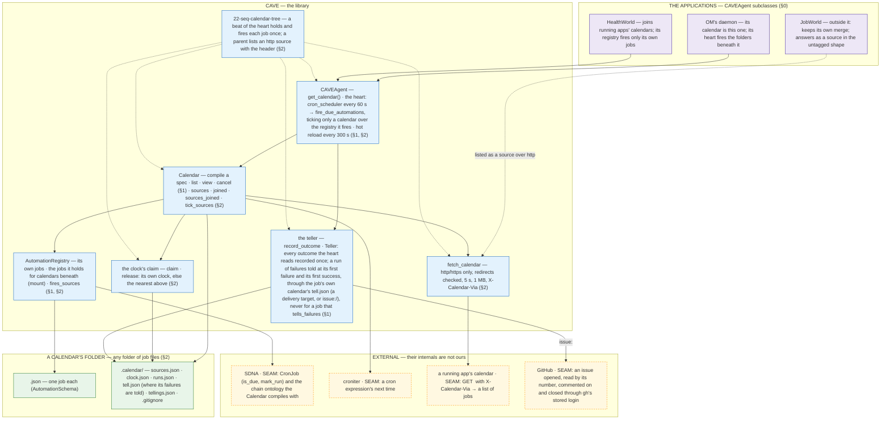

# 21 — THE ARCHITECTURE MAP (CAVE, drawn from its DESIGN.md)

<docsys kind="arch-map" role="instance"/>

TRIGGER:[CAVE's `DESIGN.md` gains, loses or renames a part (⇒ redraw this stack the same commit) · a new dev flow in
CAVE (⇒ place it on the box it runs through) · about to reason about where the calendar or the heart sits]
DO:[draw only what `DESIGN.md` names · end each external system at its seam]
NOT:[draw the parts of CAVE `DESIGN.md` has not read in yet (they are in `ARCHITECTURE.md` and `CAVEAGENT_DESIGN.md`)]

## THE STACK — the calendar and the calendar tree

